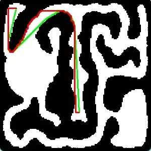

<div align="center">

# florr-autoplayer

**A full desktop automation bot for [florr.io](https://florr.io/) — a Canvas browser MMO.**

OS-level mouse/keyboard automation · OpenCV minimap vision · A\* pathfinding · optional YOLO enemy AI · CDP injection · customtkinter control panel

[](https://www.python.org/)
[](https://github.com/zyliu1985/florr-autoplayer)
[](https://github.com/TomSchimansky/CustomTkinter)
[](https://opencv.org/)
[](https://github.com/ultralytics/ultralytics)
[](cdp_bridge.py)

[](https://github.com/zyliu1985/florr-autoplayer/stargazers)
[](https://github.com/zyliu1985/florr-autoplayer/network/members)
[](https://github.com/zyliu1985/florr-autoplayer/issues)
[](https://github.com/zyliu1985/florr-autoplayer/commits)
[](LICENSE)
[](https://github.com/zyliu1985/florr-autoplayer/pulls)

[Features](#features) · [Getting Started](#getting-started) · [Maps](#maps) · [Pathfinding](#the-lazy-theta-star) · [Enemy AI](#enemy-detection-sandstorm-zone) · [Architecture](#architecture) · [Testing](#testing) · [Packaging](#packaging)

</div>

---

## Overview

`florr-autoplayer` drives a **fullscreen** florr.io tab in Chrome using real OS-level mouse/keyboard input (`pyautogui`), reads the in-game minimap with OpenCV, runs A\* pathfinding over a fixed 300×300 walkability grid, optionally runs YOLO enemy detection (`ultralytics`), injects JS into the game page over CDP, and wraps everything in a customtkinter control-panel GUI.

The whole code stands on the **CLIENT-SIDE** — nothing is injected into the game server. The bot only moves the mouse the way a human would, and reads pixels the way a human reads the screen.

> This project is **welcomed** to be used in any other florr.io projects.

---

## ⚠️ ToS Risk & Disclaimer

> **Automating florr.io likely violates its Terms of Service.**
>
> - Use a **throwaway account**.
> - This bot has **no anti-detection** beyond what the browser naturally does — no humanized mouse curves, no random delays.

---

## Features

| | Feature |
|---|---|
| 🗺️ | **4 farmable maps** — `desert`, `ocean`, `anthell`, `garden`, all with pre-calibrated wall colors, player-marker colors, and server biomes. |
| 🎯 | **Two farming modes** — see below. |
| 🧭 | **A\* pathfinding** with wall-keepout cost — prefers wide corridors, still squeezes through narrow ones, never cuts corners, and escapes walls when stuck. |
| 💀 | **Automatic respawn** — on death or start menus, clicks continue/start and begins a new round automatically. |
| 🌀 | **Teleport recovery (传送门逃生)** — if teleported to garden by a portal, pathfinds to the garden portal and walks back to the original map. |
| 🔄 | **Auto server-switch** — on repeated short rounds, queries florr.io's official server API and switches to a fresh server (disabled on anthell, where switching crashes the game). |
| 😴 | **AFK popup handling** — coexists with an external `florr-auto-afk` program so the two don't fight over the mouse. |
| 🤖 | **Enemy detection AI** *(desert only, optional)* — YOLO detects 6 mob species, reads rarity from name-tag color, flees dangerous ones, chases Mythic+ targets, kites them per-species. |
| 🕳️ | **Shortcut learning** — `learn_shortcuts.py` carves hidden map shortcuts (passages not drawn on the minimap) into any map's walkability template. |
| 🖥️ | **Status overlay** — click-through, always-on-top HUD showing the current state. |

### Farming Modes

<table>
<tr>
<th width="50%">Random area (随机区域)</th>
<th width="50%">Fixed path (固定路径)</th>
</tr>
<tr>
<td>

Frame a rectangle on the map; the bot wanders continuously inside it, **never standing still**.

</td>
<td>

Click a polyline on the map; the bot walks the path point-by-point and loops back to the start after the last point (the path's first point is the target point).

</td>
</tr>
</table>

---

## The Lazy Theta Star

After I used A\* pathing for a few months, I found this method caused a lot of time wasting on collision with florr's walls. I quickly turned to use `lazyθ*`. Here are the differences (**Green for `lazy_theta_star`**, **Red for `a_star`**):

<div align="center">
  
</div>

> *The current codebase uses the A\* variant ported from the sibling `my-auto-pathing-system/pathfinder.py` — see [Architecture](#architecture) below.*

---

## Getting Started

### Requirements

- **Python 3.11** *(REQUIRED — the pinned `torch<2.3` has no wheels for 3.12+)*
- Google Chrome

### Installation

```bash
python -m venv venv
venv\Scripts\activate
pip install -r requirements.txt
```

### Run

```bash
python main.py                    # open the control-panel GUI (normal entry point)
```

### Using the GUI

| Control | Description |
|---|---|
| Select map (选地图) | Select map: `desert` / `ocean` / `anthell` / `garden` |
| Farming mode (刷怪方式) | Pick Random area (随机区域) or Fixed path (固定路径) |
| Click target point (点目标点) | Click a target point on the map |
| Frame farming area (框刷怪区) | Frame a farming area with drag-select — Random area mode |
| Draw fixed path (画固定路径) | Left-click to draw the farming path, right-click to undo a point — Fixed path mode |
| Farming duration (刷怪时长) | Farming duration in seconds |
| Toggle enemy detection (切敌检) | Toggle enemy detection AI — off by default, needs `models/desert.pt` |
| Toggle AFK (切 AFK) | Toggle auto-AFK detection |
| Consecutive short-round threshold + Auto server-switch (连续短局阈值 + 自动换服务器) | Auto server-switch settings |
| Start/Stop (一键启停) | Click Start (开始) to start a farming run, or stop if already running |

Clicking **Start (开始)** spawns a worker subprocess that runs the actual pathfinding loop. Worker logs appear in the GUI's log box in real time — no separate console window.

### CLI Worker Mode

If you already have a ready Chrome instance (launched with the three CDP flags — see [`cdp_bridge.py`](cdp_bridge.py)), you can skip the GUI and run the bot loop directly:

```bash
python main.py --worker
```

This is equivalent to clicking **Start (开始)** in the GUI, but it **does not** launch or prepare Chrome — the GUI owns all interactive setup.

---

## Maps

To decide on the positions and areas, `map_select.py` and `area_select.py` are already prepared for you:

```bash
> python3 map_select.py            # And you click anywhere you want on the map
> Map position: (53, 144)

> python3 area_select.py           # First click the left_top bound, next click the right_bottom bound
> Area added: [(6, 5), (40, 44)]
> Final areas: [[(6, 5), (40, 44)], [(1, 43), (27, 87)]]
```

Map templates are fixed **300×300 PNGs** in `maps/` (`desert.png`, `ocean.png`, `anthell.png`, `garden.png`) — the same grid the pathfinder and player-position detection work in.

---

## Learning Hidden Shortcuts

Some maps have hidden passages that are **not** drawn on the minimap template, so a player walking through one reads as "inside a wall" to the pathfinder.

Run this live-fire tool with the game open on that map, then manually walk the shortcut once:

```bash
python learn_shortcuts.py            # default: anthell
python learn_shortcuts.py desert     # or any map in maps/
```

It polls the *raw* player marker, detects in-wall positions, and carves the walked wall segments into the map's PNG (a Bresenham line between consecutive samples), saving after each step. `Ctrl+C` to exit.

> The committed `anthell.png` has already been carved this way.

---

## Enemy Detection (Sandstorm Zone)

`auto_farming()` can chase/avoid mobs by rarity using a YOLO model.

> [!IMPORTANT]
> This needs `models/desert.pt` (**6 classes**: `scorpion`, `beetle`, `cactus`, `sandstorm`, `sand_centipede`, `soldier_fire_ant`) placed at that exact path. It is **not included** in this repo (third-party binary weights, gitignored).

Get it from [Shiny-Ladybug/assets](https://github.com/Shiny-Ladybug/assets) yourself and **verify its source before use**. Whoever/whatever wires this up should not be downloading and loading arbitrary `.pt` files from the internet without a human confirming that step — **`.pt` files are pickle-based and can execute code on load.**

See [`docs/superpowers/specs/2026-08-16-sszone-enemy-detection-design.md`](docs/superpowers/specs/) for the full design and the rarity-color-table caveats.

Enemy AI is **desert-only** for now — the bot auto-disables it on other maps (no model weights for them yet) and when `models/desert.pt` is missing.

---

## Architecture

### Process Model (GUI → Worker)

```text
python main.py  ──►  gui_app.py  ──►  spawns  ──►  python main.py --worker
     (GUI)              │                              (worker subprocess)
                        │
                        ├─ validates inputs
                        ├─ ensures dedicated Chrome via dialogs
                        ├─ asks you to F11-fullscreen florr.io
                        ├─ writes config.json
                        └─ streams worker stdout into the log box
```

- `python main.py` (no args) → `gui_app.py`. **The GUI never runs bot logic.**
- **Stop = close the worker's stdin pipe.** The worker watches stdin; on EOF it releases any held keys (so WASD/space don't stay stuck down) and exits. In the packaged `console=False` exe, this is the only reliable stop signal.
- Worker loop (`run_worker`): on death/menu screens it clicks the continue/start buttons and starts a new round automatically.

### Coordinate Spaces

> [!WARNING]
> **Never mix these two spaces.**

| # | Space | Unit | Used for | Produced by |
|---|---|---|---|---|
| 1 | **Minimap space** | Fixed 300×300 grid (same as `maps/*.png`) | Pathfinding, player position, farming areas/paths | `map_select.py`, `area_select.py`, `gui_map_picker.py` |
| 2 | **Screen space** | Physical pixels | All UI constants (measured at 1920×1080, scaled at runtime by `scale_x` / `scale_y` / `mouse_scale()` in `utils.py`) | `enemy_detect`'s aim/flee helpers, `move_to_position`'s cursor math |

`get_player_position()` and pathing produce **minimap coords**; `enemy_detect`'s aim/flee helpers and `move_to_position`'s cursor math produce **screen coords**.

### Project Structure

```text
florr-autoplayer/
├── main.py                  # Worker: A* pathfinding, move_to_position, farming loops,
│                            #   teleport recovery, run_worker
├── gui_app.py               # customtkinter control panel
├── gui_map_picker.py        # 300×300 template point/area/path picker
├── utils.py                 # screen/mouse helpers, minimap capture, player position,
│                            #   per-map wall/marker colors, server switching, death detection
├── enemy_detect.py          # YOLO enemy detection / rarity / flee / chase / Mythic kite
├── cdp_bridge.py            # minimal CDP client over WebSocket + Chrome bootstrap
├── server_lookup.py         # official florr.io server API lookup for auto-switching
├── afk_watch.py             # AFK popup coexistence with external florr-auto-afk
├── overlay.py               # click-through, always-on-top status HUD
├── app_config.py            # config.json read/write with per-key validation
├── learn_shortcuts.py       # carve hidden map shortcuts into map templates
├── map_select.py            # minimap coordinate picker
├── area_select.py           # farming-area coordinate picker
├── maps/                    # fixed 300×300 walkability templates
│   ├── desert.png
│   ├── ocean.png
│   ├── anthell.png
│   └── garden.png
├── models/                  # (gitignored) desert.pt YOLO weights
├── docs/superpowers/        # specs & plans — the "why" behind the code
│   ├── specs/
│   └── plans/
├── requirements.txt
├── pytest.ini
├── PACKAGING.md
└── LICENSE
```

### Key Modules

| Module | Responsibility |
|---|---|
| `main.py` | The worker: pathfinding (A\* with wall-keepout), `move_to_position` (blocking per-waypoint movement with an `on_tick` enemy hook), the farming loops (`auto_farming`, both modes), teleport recovery, `run_worker`. |
| `utils.py` | Screen/mouse helpers, minimap capture & player position, per-map wall/marker colors, server switching, death/start screen detection. |
| `gui_app.py` + `gui_map_picker.py` | The control panel and the map picker (point/area/path drawing on the 300×300 template). |
| `enemy_detect.py` | YOLO enemy detection / rarity / flee / chase / Mythic kite. |
| `cdp_bridge.py` | Minimal CDP client over WebSocket (eval JS, screenshots, scroll wheel) + Chrome bootstrap. |
| `server_lookup.py` | Official florr.io server API lookup for auto-switching. |
| `afk_watch.py` | AFK popup coexistence with the external `florr-auto-afk` tool. |
| `overlay.py` | Click-through, always-on-top status HUD (macOS AppKit / Windows tkinter+win32). |
| `app_config.py` | `config.json` read/write with per-key validation. |
| `learn_shortcuts.py` | Carve hidden map shortcuts into map templates. |

> [!NOTE]
> `cdp_bridge.py` requires Chrome launched with **exactly three flags**:
> ```text
> --remote-debugging-port=9222 --remote-allow-origins=* --user-data-dir=<independent profile>
> ```

### Design Docs

The *why* behind the code is documented in `docs/superpowers/{specs,plans}/2026-*.md` (resolution adaptation, Chrome bootstrap, enemy detection, AFK coexistence, zoom gating, …).

**Read the relevant one before refactoring an area.**

---

## Testing

```bash
python -m pytest                        # unit tests (mock all external state: no real Chrome/screen needed)
python -m pytest test_cdp_bridge.py     # single file
```

> [!NOTE]
> **Known quirk:** 10 tests in `test_overlay.py` are macOS-only (they assume pyobjc's `AppKit` is importable) and fail on Windows with `AttributeError: None has no attribute 'NSApplication'`. Ignore them; the Windows overlay path (`_WindowsOverlay`) is covered by the passing tests.

`pytest.ini` exists only to keep pytest from recursing into the runtime dir.

---

## Configuration

Configuration saves to `config.json` next to the script — your map/point/area or path choices, duration, and AI/AFK/server-switch toggles persist across runs.

First run has no config file yet; the app uses built-in defaults.

---

## Packaging

To package this as a standalone Windows `.exe` instead, see [`PACKAGING.md`](PACKAGING.md).

> [!IMPORTANT]
> - Build is **Windows-only** (PyInstaller doesn't cross-compile).
> - Produces a **~1 GB** one-dir build (mostly `torch`).

---

## Contributing

Contributions, bug reports, and forks into other florr.io projects are all welcome.

1. Fork the repository
2. Create your feature branch (`git checkout -b feature/amazing-feature`)
3. Commit your changes (`git commit -m 'Add some amazing feature'`)
4. Push to the branch (`git push origin feature/amazing-feature`)
5. Open a Pull Request

---

## Star History

<div align="center">

[](https://star-history.com/#zyliu1985/florr-autoplayer&Date)

</div>

---

## License

See [`LICENSE`](LICENSE).

<div align="center">

**⭐ If this project helped you, consider giving it a star!**

[](https://github.com/zyliu1985/florr-autoplayer)

</div>
